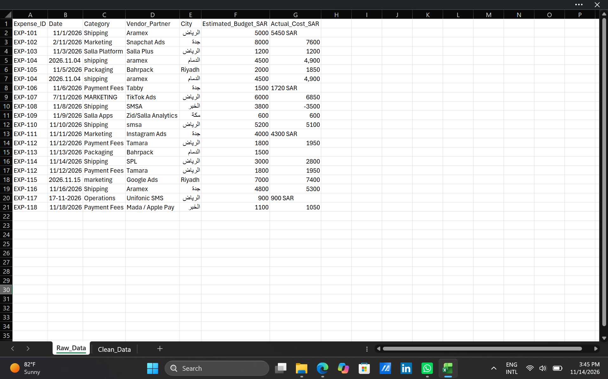
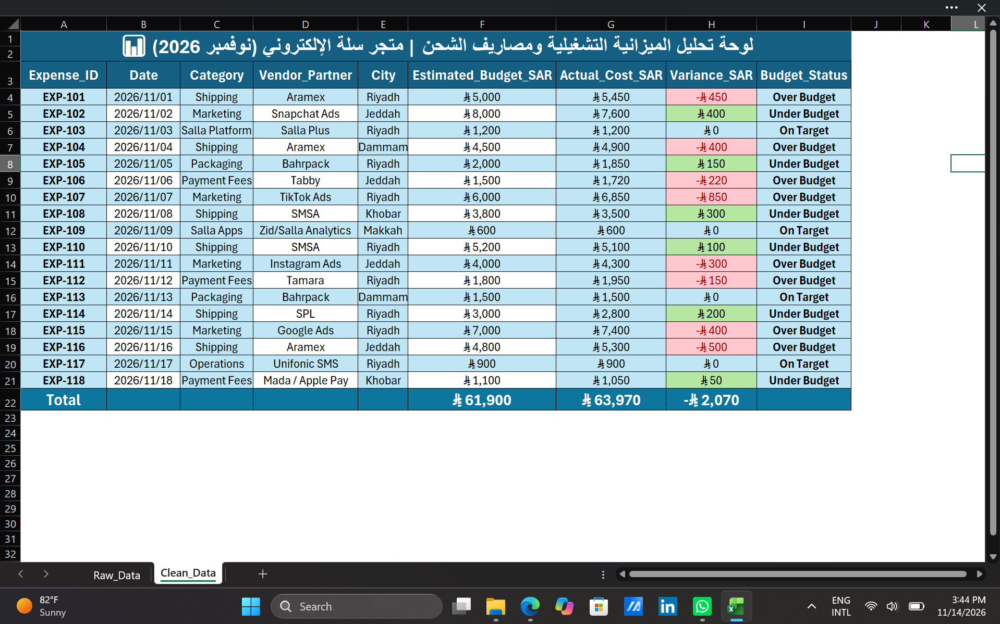

# 🛒 Salla E-Commerce Operational & Shipping Budget Variance Analytics | Executive Excel & Copilot Report


-004D3D?style=for-the-badge)
-1B5E20?style=for-the-badge)

---

## 🎯 1. الملخص التنفيذي (Executive Summary)

في ظل النمو المتسارع لقطاع التجارة الإلكترونية في المملكة العربية السعودية وتوسع المتاجر الرقمية عبر منصة **"سلة" (Salla)**، تبرز الحاجة إلى رقابة مالية دقيقة على التكاليف التشغيلية وسلاسل الإمداد لضمان استدامة هوامش الربح تماشياً مع مستهدفات **رؤية السعودية 2030**.

يقدم هذا المشروع دراسة تحليلية متكاملة لهندسة وتنظيف البيانات المالية وتحليل الانحرافات (**Budget Variance Analysis**) لمتجر إلكتروني سعودي خلال شهر **نوفمبر 2026** عبر 5 مدن رئيسية (**الرياض، جدة، الدمام، الخبر، مكة المكرمة**). شمل المشروع معالجة **20 سجلاً خاماً** وتنقيتها إلى **18 معاملة مالية فريدة** تغطي 6 قطاعات تشغيلية (الشحن، التسويق الرقمي، رسوم بوابات الدفع، التغليف، واشتراكات المنصة)، بإجمالي ميزانية تقديرية بلغت **61,900 ريال سعودي** مقابل تكلفة فعلية قدرها **63,970 ريال سعودي**، مما كشف عن صافي تجاوز مالي (**Over Budget**) بقيمة **-2,070 ريال سعودي (بنسبة 3.34%)** وتم تحديد مسبباته الجذرية بدقة.

---

## 🖼️ 2. رحلة معالجة البيانات ومعاينة التقرير (Data Transformation & Report Preview)

> **ملاحظة منهجية:** تم تطبيق دورة حياة كاملة لمعالجة البيانات (**End-to-End Data Cleaning & Modeling**) داخل بيئة **Microsoft Excel 365** مدعوماً بـ **Microsoft Copilot**، بدءاً من استلام البيانات الخام غير المهيكلة (`Raw_Data`) وصولاً إلى بناء لوحة تحليلية ذكية (`Clean_Data`) مصممة بالهوية البصرية التنفيذية السعودية (**Saudi Executive Emerald Theme**) وعملة الريال السعودي (**﷼**).

### أ. مرحلة البيانات الخام قبل التنظيف (Raw Unstructured Data — Before)
تُظهر اللقطة التالية حالة البيانات الأولية قبل المعالجة، حيث احتوت على صفوف مكررة، تباين في صيغ التواريخ، نصوص مدمجة داخل الحقول الرقمية، قيم سالبة شاذة، وبيانات مفقودة:



### ب. مرحلة البيانات النظيفة ولوحة تحليل الفروق النهائية (Clean Data & Variance Dashboard — After)
تُظهر اللقطة التالية النموذج النهائي بعد إزالة التكرارات، توحيد المعايير القياسية، تطبيق المعادلات الهيكلية الديناميكية، وتفعيل التنسيق الشرطي لتمييز الانحرافات المالية فوراً:



---

## 📊 3. ملخص مؤشرات الأداء الرئيسية (KPIs Summary)

| مؤشر الأداء (KPI) | القيمة الحالية | الدلالة الاستراتيجية والمالية |
| :--- | :---: | :--- |
| **إجمالي الميزانية التقديرية (`Estimated Budget`)** | **61,900 SAR** | السقف المالي المخطط لتغطية العمليات التشغيلية واللوجستية خلال الفترة |
| **إجمالي التكلفة الفعلية (`Actual Cost`)** | **63,970 SAR** | إجمالي المصروفات الفعلية المسجلة من واقع فواتير الموردين وشركاء النجاح |
| **صافي الانحراف المالي (`Net Variance`)** | **-2,070 SAR** | عجز إجمالي بنسبة **3.34%** عن المخطط نتيجة ارتفاع تكاليف الشحن والإعلانات |
| **أعلى بند تجاوزاً (`Top Cost Overrun`)** | **TikTok Ads (-850 SAR)** | تجاوز ميزانية حملات تيك توك بالرياض بنسبة **14.17%** عن المخصص لها |
| **أفضل بند توفيراً (`Top Cost Savings`)** | **Snapchat Ads (+400 SAR)** | تحقيق كفاءة إنفاق إعلاني في جدة وفّرت **5.00%** من الميزانية المرصودة |
| **توزيع حالات البنود (`Budget Status Split`)** | **8 Over \| 6 Under \| 4 Target** | **44.4%** من البنود تجاوزت الميزانية، مقابل **55.6%** حققت وفراً أو التزمت بالخطة |

---

## 💡 4. التحليلات العميقة ورؤى السوق (Deep Market & Financial Insights)

### أولاً: تحليل كفاءة شركاء الشحن والخدمات اللوجستية (`Shipping & Logistics — 27,050 SAR`)
* **تحدي تكاليف الشحن مع أرامكس (`Aramex Cost Overrun`):** استحوذت شركة **Aramex** على النصيب الأكبر من تجاوزات الشحن بإجمالي انحراف سلبي قدره **-1,350 SAR** عبر ثلاث مدن رئيسية: جدة (**-500 SAR**)، الرياض (**-450 SAR**)، والدمام (**-400 SAR**)، مما يشير إلى ارتفاع رسوم الوزن الإضافي أو زيادة تكلفة الدفع عند الاستلام (COD) في هذه المناطق.
* **تفوق سمسا والبريد السعودي (`SMSA & SPL Efficiency`):** في المقابل، حققت شحنات **SMSA** في الخبر والرياض وفراً مالياً بقيمة **+400 SAR**، كما حقق **البريد السعودي (SPL)** في الرياض وفراً بقيمة **+200 SAR**، مما يجعلهم خياراً أكثر استقراراً من حيث التكلفة التشغيلية.

### ثانياً: أداء القنوات التسويقية الرقمية (`Digital Marketing — 26,150 SAR`)
* **ضغط تكلفة الاستحواذ في تيك توك وجوجل (`CAC Inflation`):** سجلت حملات **TikTok Ads** في الرياض أعلى تجاوز منفرد في الجدول (**-850 SAR**)، تلتها **Google Ads** في الرياض (**-400 SAR**) و**Instagram Ads** في جدة (**-300 SAR**)، وهو ما يعكس اشتداد المنافسة الإعلانية في موسم عروض نوفمبر بالمملكة.
* **استقرار حملات سناب شات (`Snapchat Ads Optimization`):** أثبتت منصة **Snapchat Ads** في جدة أعلى كفاءة إنفاق تسويقي بتكلفة فعلية **7,600 SAR** مقارنة بميزانية **8,000 SAR** (توفير **+400 SAR**).

### ثالثاً: ديناميكية بوابات الدفع الإلكتروني (`Payment Gateways & BNPL — 4,720 SAR`)
* **ارتفاع الإقبال على الشراء الآن والدفع لاحقاً (`BNPL Surge`):** تجاوزت رسوم **Tabby** في جدة (**-220 SAR**) و**Tamara** في الرياض (**-150 SAR**) التقديرات الأولية، وهو مؤشر إيجابي على ارتفاع مبيعات التقسيط لدى العملاء السعوديين، لكنه يتطلب تعديل نسبة العمولة التقديرية في الميزانيات القادمة.
* **كفاءة المدفوعات المحلية (`Mada & Apple Pay`):** حققت عمليات الدفع عبر **مدى وApple Pay** في الخبر وفراً طفيفاً (**+50 SAR**) بفضل انخفاض رسوم المعالجة مقارنة بخدمات التقسيط.

### رابعاً: التوزيع الجغرافي والعمليات الثابتة (`Regional & Fixed Operations`)
* تتركز الكتلة التشغيلية الأكبر في **الرياض** (9 معاملات) و**جدة** (4 معاملات)، تليهما المنطقة الشرقية (**الدمام والخبر**) و**مكة المكرمة**.
* أظهرت التكاليف التقنية الثابتة مثل اشتراك **Salla Plus** (**1,200 SAR**)، وتطبيقات التحليل **Zid/Salla Analytics** (**600 SAR**)، ورسائل **Unifonic SMS** (**900 SAR**) انضباطاً مالياً بنسبة **100%** (`On Target`).

---

## 🛠️ 5. هندسة البيانات والمعالجة (Data Cleaning Pipeline & Modeling)

تم تنفيذ خطوات التنظيف والنمذجة وفق منهجية صارمة داخل ورقة العمل `Clean_Data` مع الحفاظ على نسخة أصلية معزولة في `Raw_Data`:

1. **إزالة التكرارات (`Deduplication`):** اكتشاف وحذف السجلين المكررين (`EXP-104` و `EXP-112`) لتصفية قاعدة البيانات من 20 صفاً إلى **18 صفاً فريداً** ومنع تضخم المصروفات بقيمة **6,850 SAR**.
2. **معالجة القيم الشاذة والمفقودة (`Anomaly & Null Imputation`):**
   * تصحيح إشارة التكلفة السالبة الخاطئة في المعاملة `EXP-108` من `-3500` إلى **`3,500 SAR`**.
   * معالجة القيمة المفقودة في تكلفة التغليف (`EXP-113` — شركة Bahrpack بالدمام) بتعويضها بقيمة الميزانية التقديرية المطابقة (**`1,500 SAR`**) وتوثيق الافتراض المحاسبي.
3. **تنقية النصوص وتحويل الأنواع (`Data Type Standardization`):** إزالة اللواحق النصية (`SAR`) من الحقول الرقمية وتحويلها إلى تنسيق عملة قياسي، وتوحيد أسماء المدن الخمس باللغة الإنجليزية (`Riyadh, Jeddah, Dammam, Khobar, Makkah`) وحالة الأحرف للشركات (`Aramex, SMSA`).
4. **توحيد الصيغة الزمنية (`ISO Date Formatting`):** معالجة التواريخ المعكوسة والمفصولة بنقاط أو شرطات وتحويل العمود بالكامل إلى التنسيق القياسي الموحد **`YYYY/MM/DD`**.
5. **المعادلات الهيكلية الديناميكية (`Structured Table Formulas`):**

```excel
// 1. حساب الانحراف المالي لكل معاملة بالريال السعودي (Variance_SAR)
=[@[Estimated_Budget_SAR]]-[@[Actual_Cost_SAR]]

// 2. التصنيف الإداري التلقائي لحالة الميزانية (Budget_Status)
=IF([@[Variance_SAR]]>0,"Under Budget",IF([@[Variance_SAR]]<0,"Over Budget","On Target"))
```

---

## 🚀 6. التوصيات الاستراتيجية (Strategic Recommendations)

1. **إعادة التفاوض على شرائح الشحن مع أرامكس (`Logistics Contract Optimization`):** يُوصى بمراجعة اتفاقية الأسعار مع **Aramex** أو تحويل نسبة من شحنات الرياض وجدة والدمام إلى **SMSA** و**SPL** لتقليص تجاوزات الشحن البالغة **-1,350 SAR** شهرياً.
2. **إعادة توزيع الميزانية الإعلانية (`Marketing ROAS Reallocation`):** تفعيل حدود إنفاق يومية صارمة (`Daily Spend Caps`) على حملات **TikTok Ads** في الرياض، وتوجيه جزء من الميزانية نحو **Snapchat Ads** التي أثبتت كفاءة تكلفة أعلى.
3. **تحديث معاملات رسوم التقسيط (`BNPL Fee Calibration`):** رفع المخصص التقديري لرسوم **Tabby** و**Tamara** بنسبة **12%** في ميزانية الشهر القادم لتعكس الحصة السوقية المتنامية لمدفوعات التقسيط في المتجر.
4. **أتمتة الربط المحاسبي (`Power BI & Salla API Integration`):** ربط ملف الإكسيل المنظف مباشرة مع **Microsoft Power BI** لمراقبة انحرافات الميزانية أسبوعياً بدلاً من الانتظار لنهاية الشهر.

---

## ⚙️ 7. أدوات العمل والتقنيات (Tech Stack)

* **Microsoft Excel 365:** تنظيف البيانات، الجداول الذكية (`Structured Tables`)، التنسيق الشرطي (`Conditional Formatting`)، وبناء لوحة التحليل المالي.
* **Microsoft Copilot AI:** صياغة المعادلات الشرطية، مراجعة منطق تحليل الانحرافات، وتوليد الملخصات التنفيذية.
* **Git & GitHub:** إدارة الإصدارات وتوثيق المشاريع التطبيقية ضمن سلسلة تحدي تحليل البيانات والذكاء الاصطناعي (**85 Days Data & AI Challenge**).

---

## 💻 8. كيفية تشغيل المشروع (How to Run)

1. قم بعمل Clone للمستودع عبر الأمر التالي:
   ```bash
   git clone [https://github.com/ar8ms1156-sys/Data-Analysis-and-AI-85Days.git](https://github.com/ar8ms1156-sys/Data-Analysis-and-AI-85Days.git)
   ```
2. انتقل إلى مسار المشروع داخل المجلد: `Month-2/Day-14/`
3. افتح ملف **`Salla_Operational_Budget_Variance_Nov2026.xlsx`** باستخدام برنامج **Microsoft Excel 365** لمقارنة ورقة البيانات الخام (`Raw_Data`) مع لوحة التحليل المنظفة (`Clean_Data`) واستعراض المعادلات الديناميكية.
٤.
