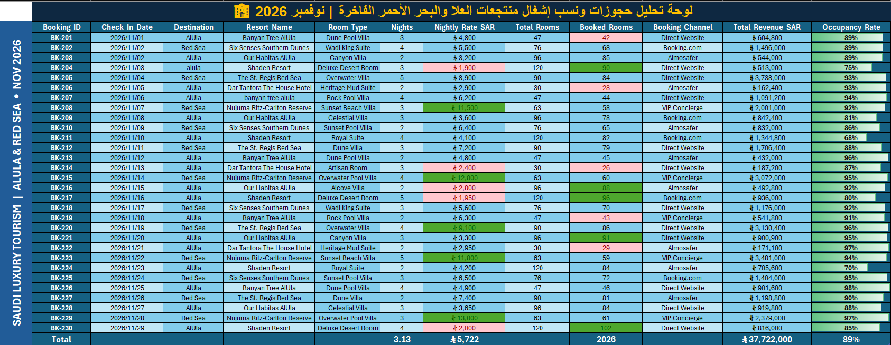

# 🏨 Saudi Luxury Hospitality & Occupancy Analytics — AlUla & Red Sea | Executive Excel & Copilot Report


-1B5E20?style=for-the-badge)

---

## 🎯 1. الملخص التنفيذي (Executive Summary)

في ظل الطفرة السياحية غير المسبوقة التي تشهدها المملكة العربية السعودية ضمن مستهدفات **رؤية السعودية 2030** لتطوير الوجهات السياحية الفاخرة عالمياً، تبرز أهمية تحليلات الضيافة وإدارة الإيرادات (**Hospitality Revenue & Occupancy Management**) لتعظيم العائد على الغرف الفندقية ورفع كفاءة التشغيل.

يقدم هذا المشروع دراسة تحليلية متكاملة لهندسة وتنظيف بيانات الحجوزات وتحليل معدلات الإشغال والإيرادات لأبرز المنتجعات الفاخرة في وجهتي **العلا (AlUla)** و**البحر الأحمر (Red Sea)** خلال شهر **نوفمبر 2026**. شمل المشروع معالجة **32 سجلاً خاماً** وتنقيتها إلى **30 معاملة حجز فريدة** تغطي 7 منتجعات عالمية، بإجمالي إيرادات بلغ **37,722,000 ريال سعودي**، ومتوسط إشغال عام وصل إلى **89%** عبر **2,026 غرفة وفيلا محجوزة**، مع تطبيق قواعد التنسيق الشرطي الذكي لتمييز الفئات الأعلى سعراً والأكثر مبيعاً فوراً لدعم قرارات التسعير والتسويق.

---

## 🖼️ 2. معاينة اللوحة التحليلية (Executive Dashboard Preview)

> **ملاحظة منهجية:** تم تنفيذ دورة حياة كاملة لمعالجة البيانات (**End-to-End Data Cleaning & Modeling**) داخل بيئة **Microsoft Excel 365** مدعوماً بـ **Microsoft Copilot**، بدءاً من عزل البيانات الخام (`Raw_Data`) وصولاً إلى بناء لوحة تحليلية تنفيذية (`Clean_Data`) مصممة بالهوية البصرية السعودية (**Saudi Executive Emerald & Gold Theme**) وعملة الريال السعودي الرسمية (**﷼**)، مع تفعيل التنسيق الشرطي وأشرطة التقدم البصرية (`Data Bars`).



---

## 📊 3. ملخص مؤشرات الأداء الرئيسية (KPIs Summary)

| مؤشر الأداء (KPI) | القيمة الحالية | الدلالة الاستراتيجية والمالية |
| :--- | :---: | :--- |
| **إجمالي الإيرادات المحققة (`Total Revenue`)** | **37,722,000 SAR** | إجمالي العوائد التشغيلية المحققة من حجوزات المنتجعات الفاخرة خلال نوفمبر 2026 |
| **متوسط نسبة الإشغال (`Avg Occupancy Rate`)** | **89%** | مؤشر تشغيلي استثنائي يعكس قوة الطلب السياحي على وجهات العلا والبحر الأحمر |
| **متوسط السعر اليومي للغرفة (`ADR`)** | **5,722 SAR** | متوسط سعر الليلة الواحدة عبر جميع فئات الفلل والأجنحة الفندقية الفاخرة |
| **إجمالي الغرف والفلل المحجوزة (`Booked Rooms`)** | **2,026 Room/Villa** | إجمالي الوحدات الفندقية المباعة فعلياً عبر قنوات الحجز المباشرة والرقمية |
| **متوسط مدة الإقامة (`Avg Length of Stay`)** | **3.13 Nights** | متوسط عدد الليالي لكل عملية حجز، مما يعزز استقرار التدفقات النقدية للمنتجعات |
| **أعلى فئة سعرية (`Peak Nightly Rate`)** | **13,000 SAR** | مسجلة لفيلا **Overwater Pool Villa** في منتجع **Nujuma Ritz-Carlton Reserve** |

---

## 💡 4. التحليلات العميقة ورؤى السوق (Deep Market & Hospitality Insights)

### أولاً: مقارنة الأداء بين الوجهتين السياحيتين (`AlUla vs. Red Sea Destinations`)
* **سيادة الفخامة فائقة القيمة في البحر الأحمر (`Ultra-Luxury Tier`):** استحوذت منتجعات البحر الأحمر (**Nujuma Ritz-Carlton Reserve**، **The St. Regis Red Sea**، و**Six Senses Southern Dunes**) على قائمة الغرف الخمس الأعلى سعراً بالكامل، بأسعار ليالي تراوحت بين **9,100 SAR** و**13,000 SAR** لفلل `Overwater Pool Villa` و`Sunset Beach Villa`.
* **قوة حجم الطلب وتنوع الفئات في العلا (`High-Volume Heritage & Eco-Luxury`):** سجلت منتجعات العلا (**Shaden Resort**، **Our Habitas AlUla**، **Banyan Tree AlUla**، و**Dar Tantora The House Hotel**) أعلى أحجام مبيعات للغرف، متصدرةً قائمة الفئات الخمس الأكثر مبيعاً بفضل مرونة الأسعار وتنوع التجارب بين التراث والطبيعة الصحراوية.

### ثانياً: تحليل الغرف الأكثر مبيعاً ونسب الإشغال (`Top-Selling Rooms & Occupancy Dynamics`)
* **تصدر فئات الإقامة الصحراوية (`Top Booked Categories`):** حققت غرفة **Deluxe Desert Room** في منتجع **Shaden Resort** أعلى رقم مبيعات منفرد بـ **102 غرفة محجوزة** (إشغال **85%**)، تلتها نفس الفئة بـ **96 غرفة** و**90 غرفة**، ثم فيلا **Canyon Villa** في **Our Habitas AlUla** بـ **91 فيلا** (إشغال **95%**).
* **ذروة الإشغال في المنتجعات البوتيكية (`Peak Occupancy Efficiency`):** سجل منتجع **Banyan Tree AlUla** أعلى معدل إشغال فردي بنسبة **98%** (حجز **46 فيلا** من أصل **47** لفئة `Dune Pool Villa`)، يليه فندق **Dar Tantora The House Hotel** بنسبة إشغال **97%** (`29` من `30` جناحاً).

### ثالثاً: سلوك قنوات الحجز والتوزيع (`Booking Channels Performance`)
* **هيمنة الحجز المباشر وكبار الشخصيات (`Direct & VIP Channels`):** أظهرت البيانات اعتماد شريحة العملاء ذوي الإنفاق المرتفع على قناتي **VIP Concierge** (خاصة في حجوزات Nujuma Ritz-Carlton التي تتجاوز قيمتها **3.48 مليون ريال** للحجز الواحد) و**Direct Website**، مما يقلل عمولات الوسطاء ويرفع صافي الربحية.
* **كفاءة المنصات الإقليمية والدولية (`OTA Contribution`):** لعبت منصة **Almosafer (المسافر)** و**Booking.com** دوراً محورياً في الحفاظ على معدلات إشغال مرتفعة تتجاوز **85%** في منتجعات العلا خلال منتصف الأسبوع.

---

## 🛠️ 5. هندسة البيانات والمعالجة (Data Cleaning Pipeline & Modeling)

تم تطبيق منهجية صارمة لتنقية البيانات ونمذجتها داخل ورقة العمل `Clean_Data` مع الإبقاء على نسخة خام معزولة في `Raw_Data`:

1. **إزالة السجلات المكررة (`Deduplication`):** اكتشاف وحذف الحجزين المكررين (`BK-204` و `BK-212`) لتصفية قاعدة البيانات من **32 صفاً خاماً** إلى **30 سجلاً فريداً** ومنع تضخم الإيرادات والغرف المحجوزة.
2. **معالجة القيم الشاذة والنصوص المدمجة (`Anomaly & Currency Cleaning`):**
   * إزالة اللواحق النصية (`SAR`) من عمود أسعار الليالي وتحويله إلى تنسيق عملة الريال السعودي القياسي (**﷼**).
   * تصحيح القيمة السالبة الخاطئة في السجل `BK-213` (منتجع Banyan Tree AlUla) من `-4800` إلى **`4,800 SAR`**.
3. **توحيد الصيغة الزمنية (`ISO Date Standardization`):** معالجة التواريخ المقلوبة والمفصولة بنقاط أو شرطات (`2026.11.03` و `02-11-2026`) وتحويل العمود بالكامل إلى التنسيق القياسي الموحد **`YYYY/MM/DD`**.
4. **توحيد التصنيفات الجغرافية (`Categorical Normalization`):** توحيد مسميات الوجهات باللغة الإنجليزية (`AlUla` و `Red Sea`) بدلاً من التباين بين العربية والإنجليزية (`العلا`، `البحر الأحمر`)، وتنسيق أسماء المنتجعات وأنواع الغرف.
5. **المعادلات الهيكلية الديناميكية (`Structured Table Formulas`):**

```excel
// 1. حساب إجمالي إيرادات الحجز بالريال السعودي (Total_Revenue_SAR)
=[@Nights]*[@[Nightly_Rate_SAR]]*[@[Booked_Rooms]]

// 2. حساب نسبة الإشغال الفندقي لكل معاملة (Occupancy_Rate)
=[@[Booked_Rooms]]/[@[Total_Rooms]]
```

---

## 🚀 6. التوصيات الاستراتيجية (Strategic Recommendations)

1. **تطبيق التسعير الديناميكي في ذروة الإشغال (`Dynamic Yield Management`):** يُوصى برفع أسعار الليالي بنسبة **10% إلى 15%** خلال عطلات نهاية الأسبوع في المنتجعات التي تتخطى نسبة إشغالها **94%** مثل **Banyan Tree AlUla** و**Dar Tantora** و**Nujuma Ritz-Carlton**.
2. **باقات تحفيزية للأجنحة الملكية (`Suite Occupancy Boost`):** إطلاق باقات إقامة شاملة للتجارب السياحية (جولات الحِجر وتأمل النجوم) لرفع إشغال فئة `Royal Suite` في **Shaden Resort** التي سجلت أقل معدل إشغال نسبي (**68%**).
3. **تعزيز برامج الولاء للحجز المباشر (`Direct Booking Incentives`):** تقديم مزايا حصرية (مثل النقل الفاخر من المطار) للعملاء الحاجزين عبر **Direct Website** و**Almosafer** لتقليل الاعتماد على منصات الحجز الدولية ذات العمولات المرتفعة.
4. **الربط التفاعلي مع Power BI (`Executive BI Automation`):** ربط ملف الإكسيل المنظف مباشرة مع **Microsoft Power BI** لمتابعة مؤشرات **ADR** و**RevPAR** (الإيراد لكل غرفة متاحة) لحظياً عبر جميع منتجعات المملكة.

---

## ⚙️ 7. أدوات العمل والتقنيات (Tech Stack)

* **Microsoft Excel 365:** تنظيف البيانات، الجداول الذكية (`Structured Tables`)، التنسيق الشرطي (`Conditional Formatting & Data Bars`)، وصف الإجماليات الديناميكي.
* **Microsoft Copilot AI:** صياغة المعادلات الحسابية، تدقيق منطق التحليل الفندقي، وبناء الملخصات التنفيذية.
* **Git & GitHub:** إدارة الإصدارات وتوثيق المشاريع التطبيقية ضمن سلسلة تحدي تحليل البيانات والذكاء الاصطناعي (**85 Days Data & AI Challenge**).

---

## 💻 8. كيفية تشغيل المشروع (How to Run)

1. قم بعمل Clone للمستودع عبر الأمر التالي:
   ```bash
   git clone [https://github.com/ar8ms1156-sys/Data-Analysis-and-AI-85Days.git](https://github.com/ar8ms1156-sys/Data-Analysis-and-AI-85Days.git)
   ```
2. انتقل إلى مسار المشروع داخل المجلد: `Month-2/Day-15/`
3. افتح ملف **`AlUla_RedSea_Hospitality_Occupancy_Nov2026.xlsx`** باستخدام برنامج **Microsoft Excel 365** لمقارنة ورقة البيانات الخام (`Raw_Data`) مع لوحة التحليل المنظفة (`Clean_Data`) واستعراض المعادلات والتنسيق الشرطي.
٤.
